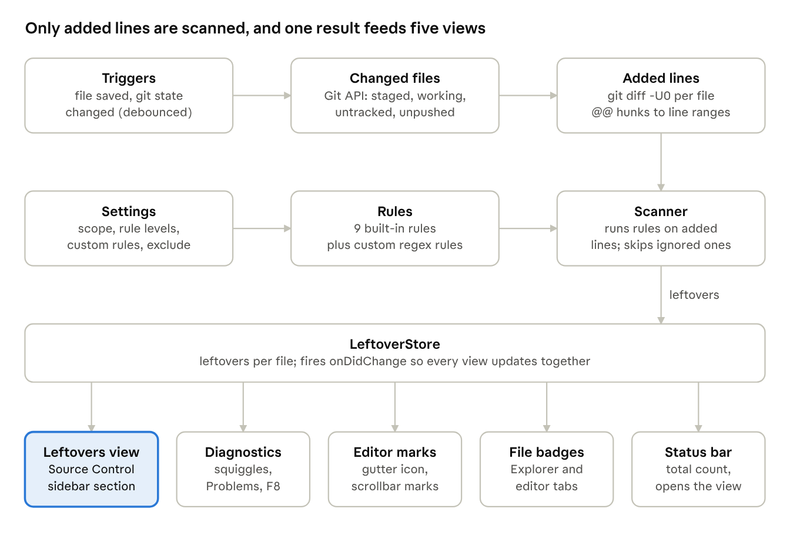
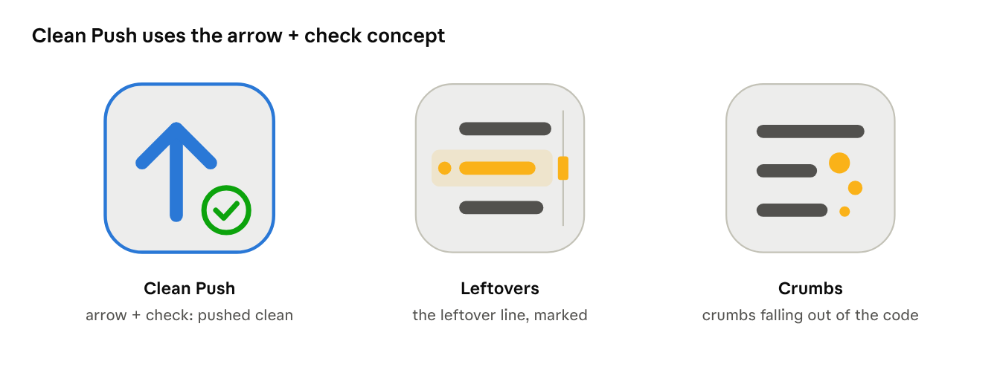

# Clean Push — VS Code Extension Design

Nov 24, 2026 · @Rajan Kumar

Clean Push finds debug leftovers in the lines you changed — console.log, debugger, .only in tests, new TODOs, secrets, merge-conflict markers — and shows them in the Source Control sidebar before you push. VS Code doesn't let other extensions recolor Git's Changes list, so it adds its own Leftovers section just below it.

## Problem and goals

Developers regularly push debug leftovers — a `console.log`, a `debugger`, a `.only` that silently skips the rest of the test suite, or a secret. Linters check whole files and are often not configured for these rules, so the leftovers get caught late in code review, or not at all.

**Goals**

- Check only the lines you added, so old code written by others doesn't nag you.
- Show leftovers in the Source Control sidebar, where you already look before committing and pushing.
- One click to jump to a leftover, and a quick fix to remove it.
- Useful with zero setup; every rule can be turned off or changed.
- Fast: a check after saving a file should feel instant.

**Non-goals**

- Not a linter replacement: no style rules, no type checking.
- Can't block VS Code's own Push or Commit buttons (VS Code gives extensions no hook for that). The optional git hook covers this.
- No AI, no network calls: everything runs locally.

## What VS Code allows

Three of your six Source Control ideas work as described, and the other three get close alternatives. Checked against VS Code's source code (see Sources).

| Your idea | Possible? | Why, and what we do instead |
| --- | --- | --- |
| Color changed files in Git's Changes list by their leftovers | No | The Source Control list renders file decorations with `colors: false`, so other extensions' colors are ignored there. Instead: our own Leftovers section with colored rows, plus colored files in the Explorer and editor tabs. |
| Small summary when hovering a file | Not on Git's rows | Git owns those rows and their tooltips. Instead: hover summary on our Leftovers rows and on the file in the Explorer. |
| New button next to Open File / Discard Changes | Possible, dropped | `scm/resourceState/context` with group `inline` could add it, but it would show on every changed file. Dropped (decided): the **Jump** button in the Leftovers section does the same job. |
| Open the file at the first leftover | Yes | **Jump** in the Leftovers section calls `window.showTextDocument` with a selection on that line. |
| Mark leftover lines on the right-side scrollbar | Yes | `overviewRulerColor` on a text editor decoration, and diagnostics add their own marks too. |
| Mark leftover lines on the minimap | No | The decoration API has no minimap option. Scrollbar marks, line highlights and gutter icons do the same job. |

## Sidebar and editor design

Leftovers show up in four places, so the user sees them wherever they are looking.

**1. Leftovers section in Source Control** — directly under Git's Changes list. Extensions may add views to the Source Control container, and inside our own view we control colors, tooltips and buttons.

```text
SOURCE CONTROL
 v Changes                                   (Git's own list, unchanged)
     api.ts          src        M
     Button.tsx      src/ui     M
 v LEFTOVERS   4 in 2 files                        [refresh] [scope]
   v api.ts                       3                [jump] [fix all]
       12  console.log("res", res)        console.log
       40  debugger                       debugger
       58  // TODO remove before merge    new TODO
   v Button.test.tsx              1                [jump] [fix all]
        7  it.only("renders", ...)        focused test
```

- File rows: name in the warning color (error color if any leftover is an error), count as the description.
- Hover a file row: *"api.ts — 3 leftovers: 1 console.log, 1 debugger, 1 TODO"*.
- Click a leftover row: opens the file at that line.
- **Jump** opens the file at its first leftover; **Fix all** removes every leftover in the file that has a safe quick fix.
- The view hides itself when there are no leftovers (decided), and its title shows the total.

**2. In the editor**

- Wavy underline and hover message on each leftover (from diagnostics).
- Colored marks on the right-side scrollbar, so the user can click to that line.
- A small icon in the gutter and a faint line highlight.
- Lightbulb quick fixes: *Remove this console.log*, *Remove .only*, *Remove all leftovers in this file*, *Ignore this line*.
- F8 / Shift+F8 jumps to the next or previous leftover (built-in for diagnostics).

**3. Problems panel** — every leftover is listed with the other warnings, filterable by the source name `clean-push`.

**4. Explorer, editor tabs and status bar** — the file name in the warning color with a count badge (`3`, or `9+`), and a status bar item *"⚠ 4 leftovers"* that focuses the Leftovers section.

## Leftover rules

Nine built-in rules, each with an id the user can turn off or re-grade in settings. Rules run only on added lines, skip comments where that makes sense, and skip any line ending in `leftover-ignore` (e.g. `console.log(x) // leftover-ignore`).

**Ignore list.** `cleanPush.ignoreList` holds calls and text that never count as leftovers. It starts with `console.warn` and `console.error` (decided), so error logging stays; remove them from the list to flag them too. Entries are plain text such as `logger.debug`, or a regex written as `/…/`.

| Rule id | Catches | Languages | Default | Quick fix |
| --- | --- | --- | --- | --- |
| `conflict-marker` | Lines starting with `<<<<<<<`, `=======`, `>>>>>>>` | All | Error | — |
| `secret` | AWS keys (`AKIA…`), GitHub tokens (`ghp_…`), private key headers, `api_key = "…"`-style assignments | All | Error | — |
| `env-file` | A `.env` file (not `.env.example`) that is changed and not ignored by git | — | Error | Add to `.gitignore` |
| `focused-test` | `.only(`, `fit(`, `fdescribe(` | JS, TS test files | Error | Remove `.only` / the `f` |
| `debugger` | `debugger;`, `breakpoint()`, `pdb.set_trace()`, `import pdb`, `binding.pry` | JS, TS, Python, Ruby | Warning | Remove line |
| `console` | `console.log`, `.debug`, `.info`, `.trace`, `.warn`, `.error`, minus anything in the ignore list | JS, TS, JSX, TSX, Vue, Svelte | Warning | Remove line |
| `print` | `print(` in Python, `System.out.println`, `fmt.Println`, `dbg!`, `var_dump`, `dd(` | Python, Java, Go, Rust, PHP | Warning | Remove line |
| `large-file` | An added file bigger than 1 MB | All | Warning | Add to `.gitignore` |
| `todo` | New `TODO`, `FIXME`, `HACK`, `XXX` comments | All | Info | — |

**Custom rules** go in settings as a regex, the languages it applies to, a severity and a message:

```json
"cleanPush.customRules": [
  {
    "id": "no-localhost-url",
    "pattern": "https?://localhost:\\d+",
    "languages": ["typescript", "javascript"],
    "severity": "warning",
    "message": "Hard-coded localhost URL"
  }
]
```

"Remove line" fixes only remove a line when the leftover is the whole statement on it; otherwise they remove just the call, so code isn't broken.

## How detection works



A save or a Git change starts a check. The Git API and `git diff -U0` narrow it to the lines you added, and one store updates every view at once.

**Which lines count as added**

| Scope | Diff run per file | Covers |
| --- | --- | --- |
| `unpushed` (default) | `git diff -U0 <base> -- <file>`, where base = `git merge-base HEAD @{upstream}` | Commits not pushed yet, staged and unstaged changes |
| `uncommitted` | `git diff -U0 HEAD -- <file>` | Staged and unstaged changes |
| `staged` | `git diff -U0 --cached -- <file>` | Staged changes only |

Untracked files count every line as added. With no upstream branch, `unpushed` falls back to `uncommitted`. Each hunk header `@@ -a,b +c,d @@` gives the added lines: c to c+d−1.

**Keeping it fast.** Only changed files are read. Excluded globs and files over `largeFileKB` are skipped. A new check cancels one still running, and results are cached per file until the file or the Git state changes.

## Code structure

TypeScript, bundled with esbuild. The rule engine has no VS Code imports, so it can be unit-tested with plain fixtures and reused later by a CLI.

```text
clean-push/
  package.json
  assets/icon.png            Marketplace icon, 256×256 PNG
  assets/icon.svg            source of icon.png
  assets/view-icon.svg       view icon, 24×24, single color
  src/
    extension.ts               activate(): wires everything together
    model.ts                   Leftover, Rule, ChangedFile types
    git/
      gitApi.ts                gets the built-in Git extension's API (vscode.git)
      changedFiles.ts          working tree + staged + untracked + unpushed commits
      addedLines.ts            runs git diff -U0 and parses @@ hunks into line ranges
    rules/
      index.ts                 built-in rule list + custom rules from settings
      conflictMarker.ts  secret.ts  envFile.ts  focusedTest.ts
      debugger.ts  console.ts  print.ts  largeFile.ts  todo.ts
    scanner.ts                 runs rules over the added lines of one file
    store.ts                   LeftoverStore: results per file + onDidChange event
    ui/
      leftoversView.ts         tree view in the Source Control container
      diagnostics.ts           DiagnosticCollection (squiggles, Problems, F8)
      editorDecorations.ts     gutter icon, line highlight, scrollbar marks
      fileDecorations.ts       Explorer / tab color + count badge
      statusBar.ts             "4 leftovers" item
    codeActions.ts             quick fixes
    commands.ts                jump, fix all, refresh, install hook
    hook/installHook.ts        optional pre-push git hook
  test/
    fixtures/                  sample diffs and source files per language
    rules.test.ts  addedLines.test.ts  extension.test.ts
```

**Main types**

```ts
type Severity = 'error' | 'warning' | 'info';

interface LineRange { start: number; end: number }   // 0-based, inclusive

interface ChangedFile {
  uri: vscode.Uri;
  addedLines: LineRange[] | 'all';   // 'all' for new / untracked files
  sizeBytes: number;
}

interface Rule {
  id: string;                          // "console"
  languages: string[] | '*';           // VS Code language ids
  severity: Severity;
  appliesToFile?(path: string): boolean; // e.g. only test files for focused-test
  check(line: string, lineNo: number): { start: number; end: number; message: string } | null;
  fix?: 'removeLine' | 'removeMatch' | 'addToGitignore';
}

interface Leftover {
  uri: vscode.Uri;
  range: vscode.Range;
  ruleId: string;
  severity: Severity;
  message: string;                     // "console.log left in code"
  fix?: Rule['fix'];
}
```

## VS Code contributions and settings

The key `package.json` entries. The Leftovers view goes into the built-in `scm` container. There is no button on Git's own rows (decided), so the `scm/resourceState/context` menu isn't used.

```json
{
  "name": "clean-push",
  "displayName": "Clean Push: catch leftovers before you push",
  "icon": "assets/icon.png",
  "keywords": ["console.log", "debugger", "leftovers", "pre-push", "secrets", "git"],
  "extensionDependencies": ["vscode.git"],
  "activationEvents": ["workspaceContains:.git"],
  "contributes": {
    "views": {
      "scm": [
        { "id": "cleanPush.leftovers", "name": "Leftovers", "icon": "assets/view-icon.svg", "when": "cleanPush.hasLeftovers" }
      ]
    },
    "commands": [
      { "command": "cleanPush.openFirstLeftover", "title": "Go to First Leftover", "icon": "$(checklist)" },
      { "command": "cleanPush.fixAllInFile",     "title": "Fix All Leftovers in File", "icon": "$(wand)" },
      { "command": "cleanPush.refresh",          "title": "Refresh", "icon": "$(refresh)" },
      { "command": "cleanPush.changeScope",      "title": "Change Scope", "icon": "$(filter)" },
      { "command": "cleanPush.installHook",      "title": "Clean Push: Install Git Pre-push Hook" }
    ],
    "menus": {
      "view/title": [
        { "command": "cleanPush.refresh",     "when": "view == cleanPush.leftovers", "group": "navigation" },
        { "command": "cleanPush.changeScope", "when": "view == cleanPush.leftovers", "group": "navigation" }
      ],
      "view/item/context": [
        { "command": "cleanPush.openFirstLeftover", "when": "viewItem == leftoverFile", "group": "inline" },
        { "command": "cleanPush.fixAllInFile",     "when": "viewItem == leftoverFile", "group": "inline" }
      ]
    }
  }
}
```

**Settings**

| Setting | Default | What it does |
| --- | --- | --- |
| `cleanPush.scope` | `unpushed` (decided) | `unpushed` = uncommitted + staged + commits not pushed yet; or `uncommitted`, or `staged` |
| `cleanPush.rules` | see rules table | Per rule: `error`, `warning`, `info` or `off` |
| `cleanPush.ignoreList` | `console.warn`, `console.error` | Calls or text that never count as leftovers; `/…/` for a regex |
| `cleanPush.customRules` | `[]` | Extra regex rules |
| `cleanPush.exclude` | `**/dist/**`, `**/vendor/**`, `**/*.min.js`, lockfiles | Files never checked |
| `cleanPush.largeFileKB` | `1024` | Size for the `large-file` rule; bigger files aren't scanned |
| `cleanPush.ignoreComment` | `leftover-ignore` | Marker that skips a line |
| `cleanPush.decorateExplorer` | `true` | Color and count badge in Explorer and tabs |

Checks run only after a file is saved or the Git state changes (decided); there is no check-as-you-type option.

## Optional pre-push git hook

VS Code gives extensions no way to stop its Push button, so a hard stop needs a real git hook. The command **Clean Push: Install Git Pre-push Hook** writes one, on request only.

**What the hook blocks.** Only the error-level rules that are easy to check in shell: conflict markers, `.only(`, a bare `debugger`, private key headers and AWS keys. Warnings like `console.log` never block a push. `git push --no-verify` skips it, as with any git hook.

**Why plain shell.** The hook can't call the extension's code, because the extension's install folder changes on every update. A POSIX `sh` script works on Linux and macOS, and on Windows through the `sh` that ships with Git for Windows.

**Not breaking existing hooks**

1. If `git config core.hooksPath` is set (Husky, lefthook and similar tools), don't write anything. Show the lines to add to their own pre-push hook instead.
2. If `.git/hooks/pre-push` exists and isn't ours, don't overwrite it. Offer to show the lines to append.
3. Our file starts with the marker `# clean-push v1`, so the extension can update or remove it safely (**Uninstall Git Pre-push Hook**).

```sh
#!/bin/sh
# clean-push v1 (installed by the Clean Push VS Code extension)
is_zero() { case "$1" in *[!0]*) return 1 ;; *) return 0 ;; esac; }
pattern='^\+(<<<<<<< |>>>>>>> )|\.only\(|^\+[[:space:]]*debugger;?[[:space:]]*$|-----BEGIN [A-Z ]*PRIVATE KEY-----|AKIA[0-9A-Z]{16}'
status=0
while read -r local_ref local_sha remote_ref remote_sha; do
  is_zero "$local_sha" && continue                     # deleting a branch
  if is_zero "$remote_sha"; then
    commits="$local_sha --not --remotes"               # new branch
  else
    commits="$remote_sha..$local_sha"
  fi
  hits=$(git log -p --format= $commits | grep '^+' | grep -v '^+++' | grep -E "$pattern")
  if [ -n "$hits" ]; then
    echo "clean-push: leftovers in commits for $remote_ref:"
    echo "$hits" | head -n 20
    status=1
  fi
done
[ "$status" = 1 ] && echo "Fix them, or push anyway with: git push --no-verify"
exit $status
```

## Milestones

Each version works on its own and can be released.

1. **v0.1 — Warnings in the editor.** Changed-file and added-line detection through the Git API and `git diff -U0`, run after each save; the rule engine with `console` (and the ignore list), `debugger`, `focused-test`, `conflict-marker` and `todo`, shown as diagnostics (squiggles, Problems panel, scrollbar marks, F8). Done when a new `console.log` shows a warning right after saving.
2. **v0.2 — Leftovers in Source Control.** The Leftovers view with counts, hover summaries, jump and click-to-line, hidden when empty; the status bar item.
3. **v0.3 — Fixing.** Quick fixes and Fix all, Explorer and tab badges, `leftover-ignore`.
4. **v0.4 — Safety rules.** `secret`, `env-file`, `large-file`, `print` for more languages, custom rules, the scope setting.
5. **v1.0 — Release.** The optional git hook with install and uninstall, tests on Linux, macOS and Windows, README with GIFs, Marketplace listing.

## Name and Marketplace icon

Decided: **Clean Push** (extension ID `<your-publisher>.clean-push`, settings prefix `cleanPush.`). It says the result — a push with nothing left behind — and a web search on 24 Nov 2026 found no VS Code extension using it. The other names below were considered.

| Name | Marketplace display name | For | Against |
| --- | --- | --- | --- |
| **Clean Push** (recommended) | Clean Push: catch leftovers before you push | Says the outcome; easy to remember and search | Doesn't say console.log, so keywords must carry that |
| Leftovers | Leftovers: find debug code in your diff | Short; matches the sidebar's own wording | Common word, so search results are noisy |
| Pre-push Check | Pre-push Check | Plain and exact | Sounds like only a git hook |
| Crumbs | Crumbs: what you left in your diff | Playful and distinctive | Needs a tagline to explain it |

Avoid **Push Guard** and **CodeSweep** (or *Diff Sweep*): the same search found extensions already using those names. Whatever the name, put the search words in `keywords`: `console.log`, `debugger`, `leftovers`, `pre-push`, `secrets`, `git`.



The final icon uses the arrow + check concept and lives in `clean-push/assets/`: `icon.png` (256 × 256, the Marketplace icon), `icon.svg` (its source) and `view-icon.svg` (24 × 24, single color) for the Leftovers view if a user drags it out of Source Control. The Marketplace needs a PNG of at least 128 × 128 px; SVG isn't accepted for the `icon` field.

## Open questions

- [x] Keep the button on Git's rows even though it shows on every changed file, not only files with leftovers?Answer: NO, dont add leftovers button on git rows
- [x] Default scope: `unpushed` (everything not yet on the remote) or `uncommitted` only?Answer: unpushed
- [x] Should `console.warn` and `console.error` count as leftovers? We will have a ignorelist(they will be there)
- [x] When there are no leftovers, hide the Leftovers view (current design) or show "No leftovers" with a check mark?Answer: hide leftovers view
- [x] Check unsaved edits as you type, or only after saving? (Saving is simpler and cheaper; typing feels faster.) Answer:only after saving
- [x] Marketplace name: "Pre-push Check", "Leftovers", or something else? suggest me some names and a marketplace icon.

  **Answer (Claude):** Done: **Clean Push**, with the arrow + check icon. The files are in `clean-push/assets/`; details are in the Name and Marketplace icon section.

## Sources

VS Code source files checked on 24 Nov 2026 (main branch):

- [scmViewPane.ts](https://github.com/microsoft/vscode/blob/main/src/vs/workbench/contrib/scm/browser/scmViewPane.ts) — Source Control rows render file decorations with `colors: false`.
- [menus.ts](https://github.com/microsoft/vscode/blob/main/src/vs/workbench/contrib/scm/browser/menus.ts) — a row's menu context carries only `scmResourceState`, the group and the provider, not the file path.
- [vscode.d.ts](https://github.com/microsoft/vscode/blob/main/src/vscode-dts/vscode.d.ts) — editor decorations support `overviewRulerColor` and have no minimap option.
